# Doseline

A private medication tracker for Windows. It reminds you before every dose, escalates when a dose is overdue, keeps a
log of what you took, and can mirror your next dose to Google Calendar. Everything is stored on your PC.

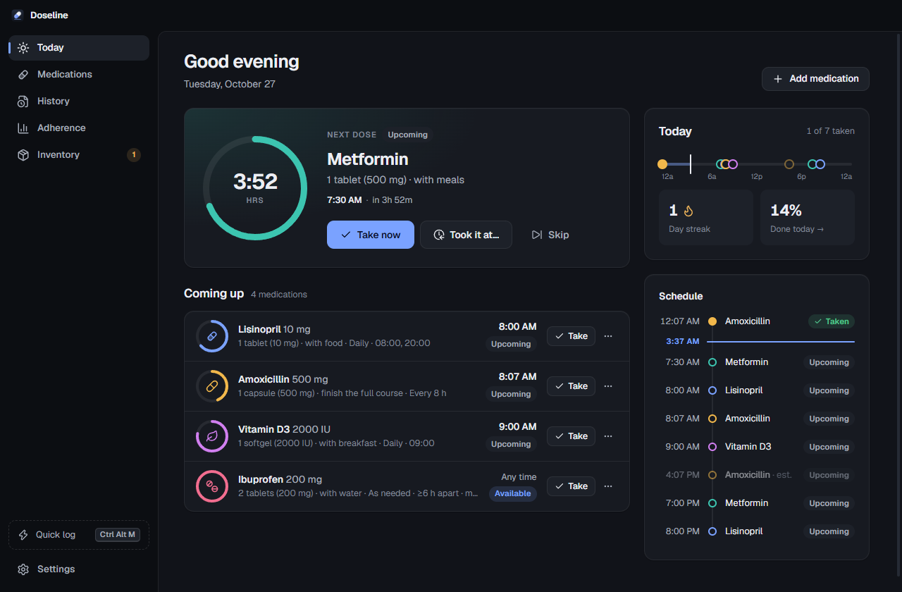

> [!IMPORTANT]
> **Medical disclaimer.** Doseline is a personal reminder and logging tool. It is **not medical advice and not a
> medical device**, and it has not been evaluated or approved by any regulator. Always follow your prescriber's and
> pharmacist's instructions. Do not rely on Doseline, or any app, as the only safeguard for critical medications.
> Alarms can fail: for example if your PC is off, asleep, muted, or the app is not running.

**[Download the latest release](https://github.com/Nocturnxl/doseline/releases/latest)** (Windows 10/11, x64): the
installer `Doseline-Setup-x.y.z.exe`, or the portable `Doseline-x.y.z-Portable.exe`.

## Screenshots

| | |
|---|---|
| 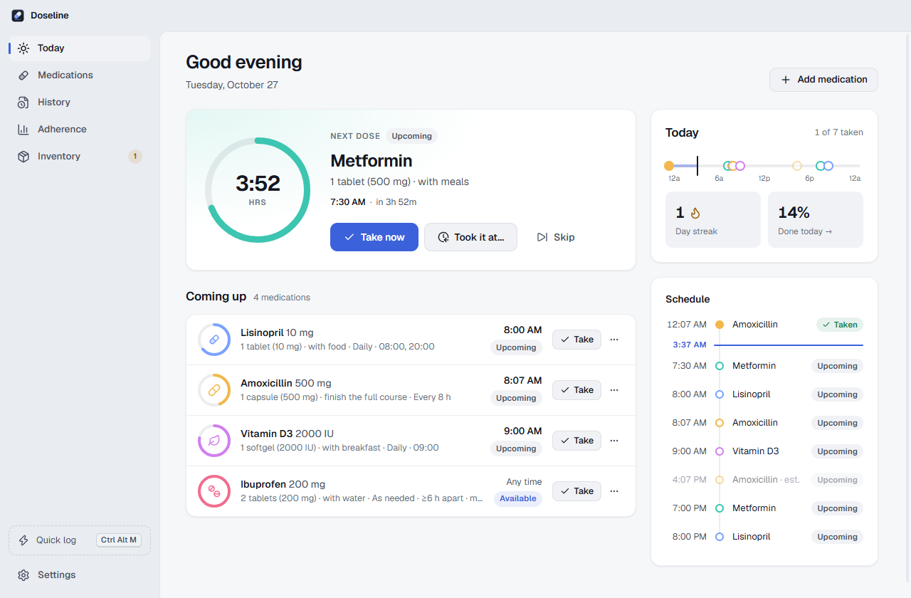 | 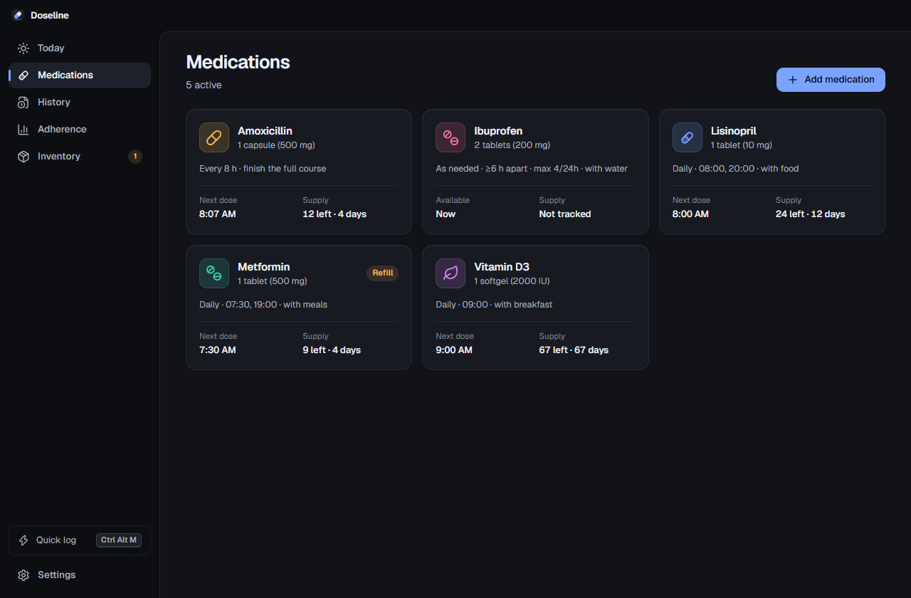 |
| 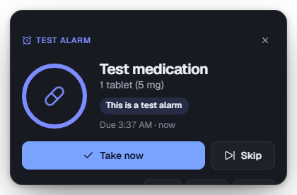 | 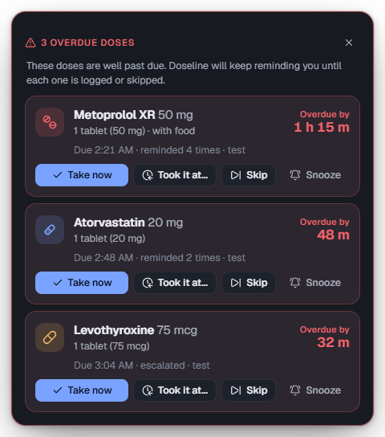 |
| 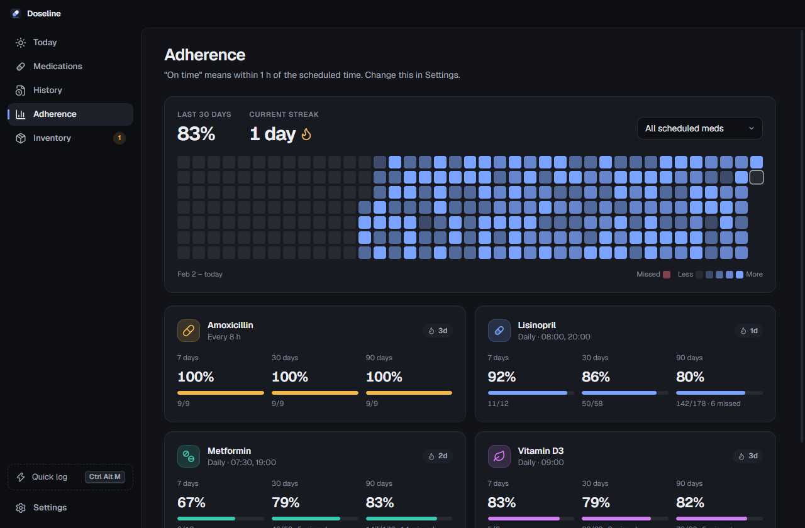 | 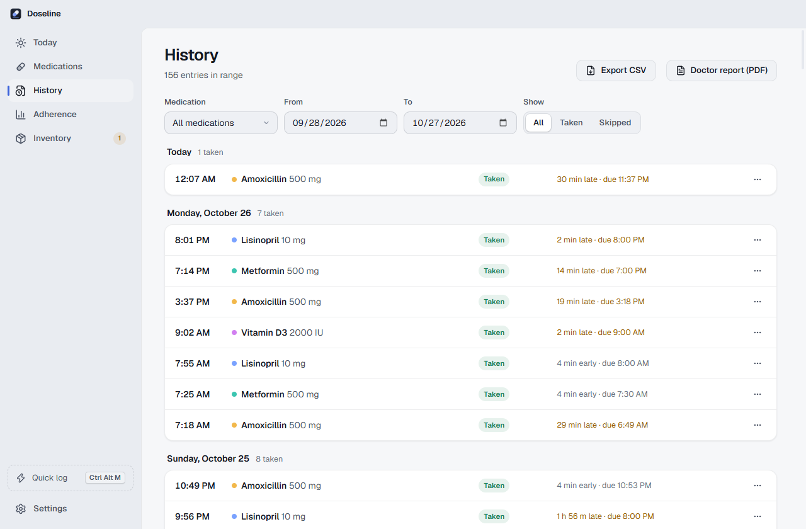 |
| 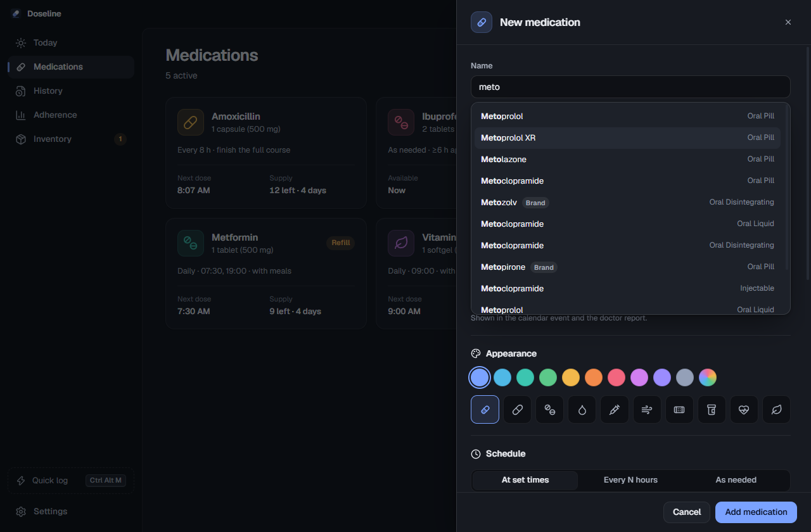 | 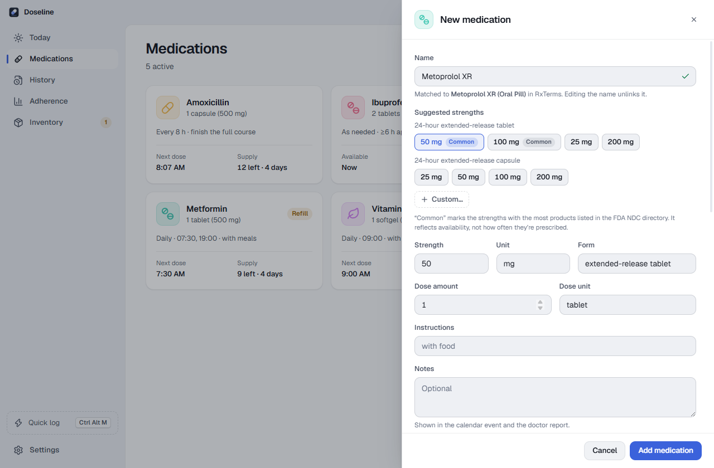 |
| 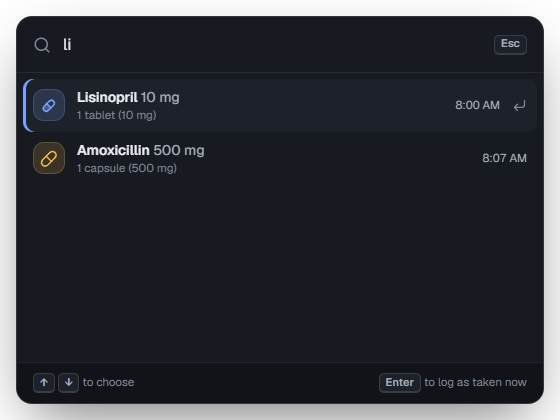 | 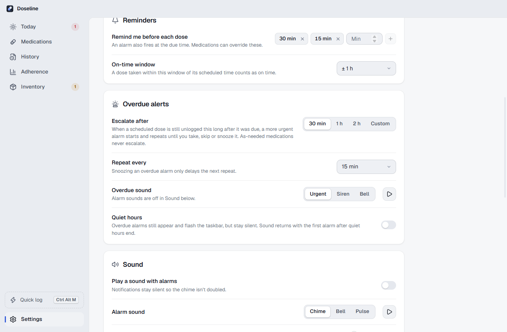 |

All screenshots use the fictional demo dataset (see [Developer tools](#developer-tools)). More are in
[docs/screenshots](docs/screenshots).

## Features

- **Today dashboard:** upcoming doses with countdown rings, status (upcoming, due, overdue, escalated, taken, skipped, missed), one-click logging and a timeline of the day.
- **Three schedule types:** every N hours (counted from the last dose), at set times on chosen weekdays, or as needed (with a minimum interval and an optional 24-hour cap).
- **Logging:** Take now, Took it at… (backdate), Skip, and a 10-second Undo that reverses inventory, calendar and alarms. Warnings for doses taken too soon, over the daily cap or likely duplicated; they never block you.
- **Local alarms:** reminders before each dose (30 and 15 minutes by default, editable per medication). Each one shows a Windows notification and an always-on-top alarm window with a bundled sound, Take, Skip and Snooze.
- **Overdue escalation:** if a scheduled dose is still unlogged a set time after it was due, a more urgent alarm starts and repeats until you act.
  - The threshold defaults to 30 min (1 h, 2 h, custom, or off per medication); the repeat interval defaults to 15 min.
  - Several overdue medications share one window and one sound per cycle.
  - Optional quiet hours keep it visible but silent.
- **Reliable timing:** alarms are recomputed after sleep, restart, clock or time-zone changes and daylight-saving transitions. Anything that came due while the PC was off appears once in a "Missed while you were away" summary, never as a burst of old alarms.
- **Drug-name autocomplete** (optional, online) from the U.S. National Library of Medicine's RxTerms. Picking a drug suggests its real strengths, ordered by what you've used before and by how many products the FDA lists. Free text always works.
- **History, adherence and inventory:** edit or delete entries; on-time rates, streaks and a calendar heatmap; units on hand, days of supply and refill alerts.
- **Export:** CSV history, a printable PDF report for a doctor's visit, and full JSON backup and restore.
- **Google Calendar (optional):** one "next dose" event per medication in a dedicated *Medications* calendar, with matching pop-up reminders. Changes queue while offline.
- **System integration:** tray icon with quick-log, launch at sign-in, a global quick-log shortcut (Ctrl+Alt+M), and a single running instance.
- **Design:** dark and light themes (or follow Windows), Windows 11 Mica, keyboard accessible, and it respects reduced-motion settings.

## Install

1. Download the installer (or the portable exe) from the [latest release](https://github.com/Nocturnxl/doseline/releases/latest).
2. Run it. It installs per-user and needs no administrator rights.

The builds are **not code-signed**, so Windows SmartScreen will warn that the publisher is unknown. Click
**More info → Run anyway**. If you prefer, you can [build it from source](#build-from-source) instead.

Your data is stored in `%APPDATA%\Doseline\`. Uninstalling keeps it; delete that folder to remove it.

## Google Calendar sync (optional)

Doseline works fully without Google: reminders, alarms, logging, history, adherence and exports are all local.

To sync with Google Calendar you need to **create your own free Google Cloud OAuth client** and paste its ID and
secret into Doseline. No shared credentials ship with the app. It takes about five minutes, and every step is in
**[SETUP.md](SETUP.md)**.

Doseline asks only for the `calendar.app.created` permission. It can create and manage its own *Medications*
calendar, and it cannot read or change your other calendars.

## Privacy

- **Your data stays on your PC.** Medications, history, settings and logs live in `%APPDATA%\Doseline\`. There are no accounts, analytics or telemetry.
- **Online drug lookup** (on by default, can be turned off in Settings → Drug lookup):
  - The text you type in the medication name field is sent to the NLM's [RxTerms API](https://clinicaltables.nlm.nih.gov/apidoc/rxterms/v3/doc.html).
  - When you pick a drug, its RxNorm codes are sent to [openFDA](https://open.fda.gov/apis/drug/ndc/).
  - No account, name or other identifier is sent with these requests.
- **Google Calendar**, only if you connect it: your next-dose events go to your own Google Calendar through your own OAuth client. Credentials are encrypted on your PC with Windows DPAPI.
- **Nothing is sent anywhere else.**

## Build from source

Requirements: Windows 10/11 x64 and Node.js 22.12 or newer. No C++ toolchain is needed.

```bash
git clone https://github.com/Nocturnxl/doseline.git
```

```bash
cd doseline
```

```bash
npm ci
```

```bash
npm run dev
```

| Script | What it does |
|---|---|
| `npm run dev` | Start the app with a hot-reloading renderer |
| `npm test` | Unit tests (schedules, DST, alarms, escalation, sync, adherence, drug lookup, database) |
| `npm run test:live` | Opt-in smoke test against the real RxTerms and openFDA APIs (needs internet) |
| `npm run typecheck` | Strict TypeScript for main and preload, renderer, and core |
| `npm run dist` | Build, then package an NSIS installer and a portable exe into `release/` |

Releases are built by GitHub Actions when a `v*` tag is pushed; the installer and portable exe are attached to the
GitHub Release.

### Project layout

```
src/core/       Pure TypeScript domain logic (no Electron or Node imports): schedules, alarms,
                escalation, adherence, inventory, calendar sync, drug lookup.
src/main/       Electron main process: SQLite, encrypted credential storage, OAuth, windows, tray, IPC.
src/preload/    The typed bridge exposed to the renderer.
src/renderer/   React UI: main window, alarm window, quick-log palette, printable report.
tests/          Recorded API fixtures and the opt-in live smoke test.
scripts/        Icon, sound and fixture generators.
```

Design decisions and their reasoning are in [DECISIONS.md](DECISIONS.md); the history of changes is in
[CHANGELOG.md](CHANGELOG.md).

### Developer tools

In **Settings → About**, click the version label five times to reveal developer tools:

- **Load demo data:** replaces everything with fictional medications and about six months of history. It is refused while Google is connected.
- **Fire a test alarm**, or **preview the overdue alarm** (single or consolidated).
- **Create test doses** due in 1 or 2 minutes, to exercise reminders and escalation end to end.

Set `DOSELINE_USER_DATA=<folder>` to run against a throwaway profile.

## Security

Please report vulnerabilities privately. See [SECURITY.md](SECURITY.md).

## License

[MIT](LICENSE)
